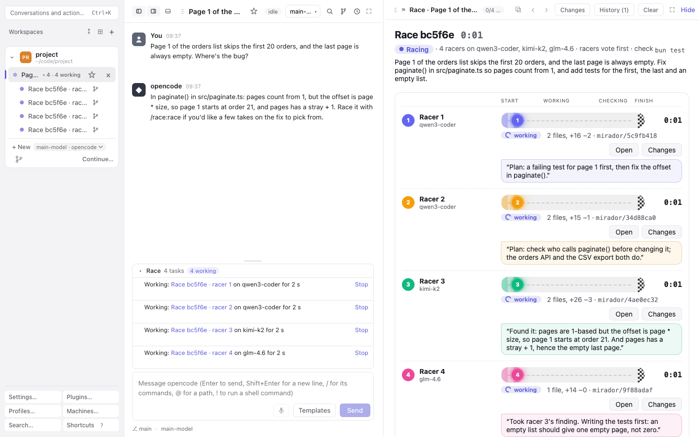
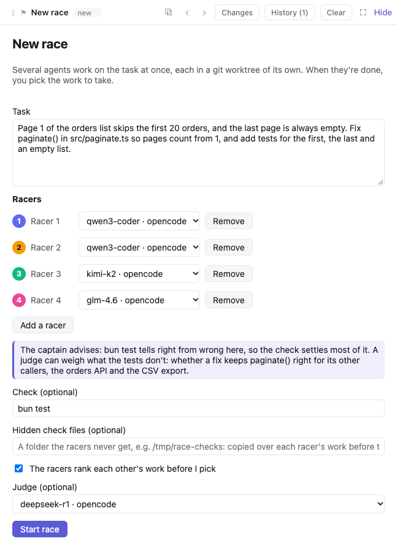
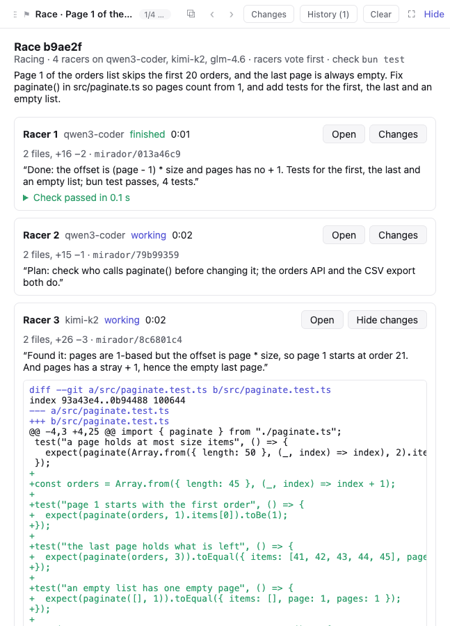
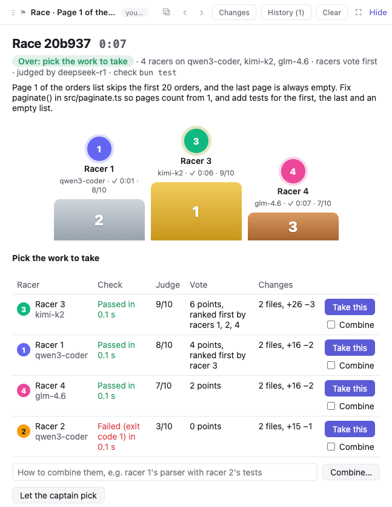
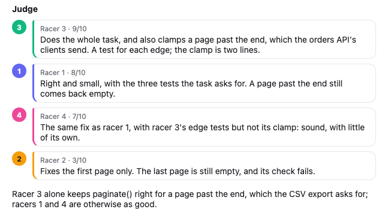

# Race

A [Mirador](https://github.com/sodre90/mirador) plugin that races a task on several agents at once, on one profile, such as four of a small local model, or on one of several profiles each, to compare them, and has them work as a team: each works in a git worktree and branch of its own, and they share a board where they post what they learn. Only you start a race: an agent's call fills in the race's form for you to check and start. When all have finished, you take the best work, or combine the best parts, from the race page, or let the conversation that started the race pick and merge it. Race also runs [benchmarks](#benchmarks): every problem of a set on each model you choose, with a leaderboard of the models that ran on it.



- `race({ task, profile, profiles, racers, check, checkFiles, decide, judge, advice })`, called by an agent, only drafts the race: it puts the race's form on the canvas, filled in with what the agent asked, and nothing runs until you check it and press **Start race**. It refuses a draft without a task, or one naming a profile Mirador doesn't have; with no profile named, you choose them on the form. The agent can advise on hidden check files and a judge, and the form shows its advice above them. The racers run on `profile`, or on `profiles` in turn, one racer each when several are named; there are `racers` of them (2 to 6), else 4. Each racer gets the task, then how to race: read the board first, post its plan, peek at the others' work and borrow what helps, run the check, commit on its branch, post a last note.
- `/race:race` with nothing after it opens a form on the canvas: the task, a profile for each racer, the check, and whether the racers vote. `/race:race task=… profile=…` starts the race at once. Every race waits for your pick.
- `race_board({ post })` reads the notes the others posted since the racer last read, and where each racer stands, and posts a note. The conversation that started the race can post too, to steer them.
- `race_peek({ racer })` shows a racer's work since the race began as a diff, committed or not, new files included, without touching that racer's staging.
- `check` is a command, such as the project's tests, that each racer runs before it finishes. Race also runs it itself in each racer's folder once that racer is done, in your login shell, two at a time, for up to 20 minutes, keeping the end of what it printed; **Stop race** stops it. That includes a check an agent drafted, once you press **Start race**, so read it on the form first.
- `checkFiles` is a folder of check files the racers never get, such as hidden tests, given as a full path. Just before Race runs the check in a racer's folder, it copies them over that folder at the same paths, and afterwards it puts back what the racer had, so a racer can't pass by changing the tests it was given. Keep the folder outside the workspace's repository, or uncommitted, so the racers don't branch with it, and give a check that runs the hidden files, such as the project's whole test suite.
- With `decide: "vote"`, the finished racers first rank each other's work with `race_vote`, hearing what Race's check said. Each ranking gives a racer a point for each racer ranked below it, so abstaining takes nothing from anyone; two racers that each rank the other first are a tie, and the page and the captain hear who ranked whom first and why.
- With `judge`, a profile you name, a judge starts once every racer is checked and the vote is over: a conversation beside the captain's that reads each finished racer's work against the task with `race_peek`, and scores it from 0 to 10 with reasons through `race_judge`, for what a check can't tell, such as whether the work does the whole task and how well it is made. Its scores order the results and the podium after the check, and the captain hears them; **Skip the judge** goes on without it.
- Once every racer has finished, been stopped or failed, the conversation that started the race hears it as its next message: each racer's profile, branch, folder, changes, check and last words, and the vote if there was one. It only says the race waits for your pick, and the page offers **Take this** for each racer, **Combine…** for the ones you tick, with how, and **Let the captain pick**, which go to it as your message. Once the work is taken, **Delete the racers** deletes their conversations, worktrees and branches, and keeps each one's changes on the page.
- The race page is a track: each racer runs on a lane of its own colour from the start, through its work and Race's check, to a checkered finish, with its profile, state and time, what it changed, its latest note and Race's check with its output, **Open** for its conversation and **Changes** for its work inline. A long task shows folded. Below are the board, each note beside its racer's colour, and the vote. Once it's over, a podium shows the racers whose work passed Race's check, or, in a race without a check, that the judge scored, best first: by the judge, then the vote, then the quicker. Only work that passed, or that the judge scored in a race without a check, earns a place, and a check that passes while you watch gets a burst of confetti.









Racers branch from the workspace's last commit, so work the main checkout hasn't committed isn't in their folders. A new worktree has no installed dependencies either: set the workspace's **Setup command for a new worktree** under *Where conversations work*, such as `bun install`, so each racer's check can run.

Needs Mirador's plugin API 16, which lets a plugin's page start conversations, open them, delete the conversations the plugin started with their worktrees, and list the profiles with the model and effort each sets. The workspace must be in a git repository with a commit.

## Benchmarks

Race also runs benchmarks: every problem of a set on each profile you choose, each racer alone in a worktree of its own, so a score measures one model. A problem set is the top folder of a git repository, opened as a Mirador workspace. Its `set.json` names the set and sets the check's time limit, the racers' time limit and the tries. Under `problems/<id>/`, each problem has `problem.json` (its check command, start commit and tags), `task.md` (the racer's task, word for word), `check/` (the hidden check files, copied over the racer's own at check time) and `reference/` (a known solution). Each problem starts from its own commit of the set's repository, so every racer begins from the same untouched tree; a problem is valid only when its check fails on that starting tree and passes with the reference solution.

Run one with `/race:bench` in a conversation whose workspace is the set, or ask the agent to run a benchmark: its call fills in the run's form for you to check and start. You choose the columns, a profile each with a model and effort if you like, and every problem runs on each column, a few racers of one profile at a time.

The run page lays the problems out against the columns: each cell shows its racer's result and time, opens its conversation and shows its changes, and each column totals the problems it solved, its median time and its tokens and cost.

A racer whose check fails gets one more turn with what the check printed — the tests are right, fix the code — unless the set allows only one try; results show passes on try 1 and on try 2. A racer that works past the set's time limit is stopped and its cell timed out, and each check runs under the set's check time limit. A run carries on when its page loads after a Mirador restart.

Each ended run leaves its results in the set's `runs/` folder, as `<date>-<run id>.json`: every cell's result, tries, time, tokens and cost, with the totals. The conversation that started the run hears a one-line summary when it is over.

Import the Aider Polyglot benchmark (225 Exercism problems in six languages) with `bun scripts/import-polyglot.ts <polyglot checkout> <set folder>`, where the checkout is a clone of exercism/polyglot; `--languages python,go` and `--limit <n per language>` import a part of it.

A set can run its checks in a container: give `set.json` a `container` with an `image` and a `workdir`, and each check copies the racer's folder — the files git tracks and the untracked ones, not the ignored ones — into a fresh container of that image, copies the problem's check files over them, runs the check there and removes the container. Add `host` to check on another machine over ssh, and `engine` (`docker` or `podman`) to pick the engine; it is docker on this machine and podman over ssh unless the set says otherwise. The check's time limit and **Stop run** work as they do here. The machine that checks needs Docker or Podman.

Import SWE-bench Verified Mini (50 real GitHub issues) with `bun scripts/import-swebench.ts <set folder>`; `--limit n` imports the first n. It reads the dataset from Hugging Face and fetches each issue's base commit from GitHub into the set's repository; `--rows <file>` and `--base-url <url>` read the dataset and the repositories from elsewhere. Each check runs SWE-bench's own harness, which starts Docker containers of its own, so this set has no `container`. It needs Docker, [uv](https://docs.astral.sh/uv/) (for `uvx`), about 10 GB free per check at once, and network access; the harness removes each instance's image once checked. SWE-bench publishes x86_64 images only: on an Apple Silicon Mac each check pulls its instance's image for linux/amd64, and Docker runs it under emulation.

## Develop

```bash
bun install
bun run typecheck
bun run test     # unit tests
scripts/e2e.sh   # e2e in a Mirador test host from MIRADOR_DIR, with Mirador's Playwright
MIRADOR_SCREENSHOTS=1 scripts/e2e.sh e2e/screenshots.spec.ts   # retakes the pictures in screenshots/
```

`MIRADOR_DIR` is Mirador's checkout, by default `../visualized-claude-sessions`.
